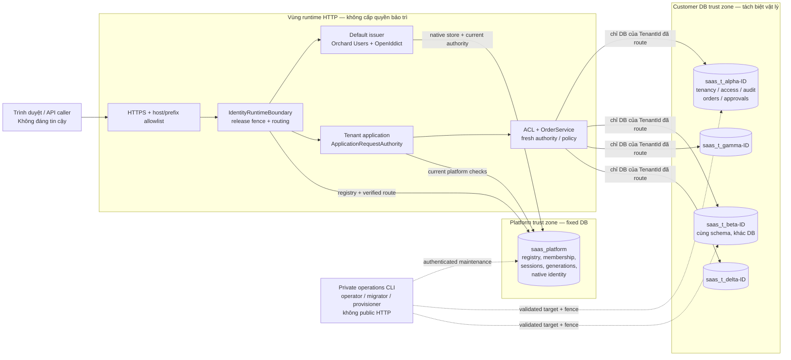
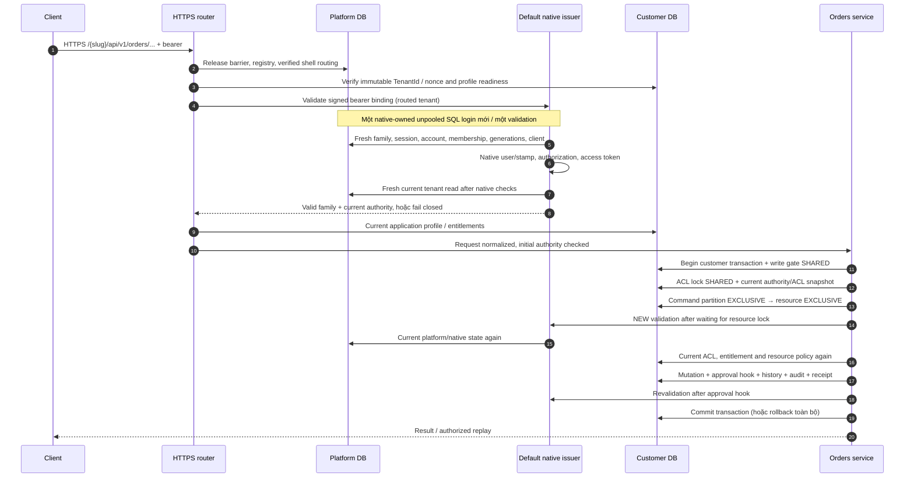
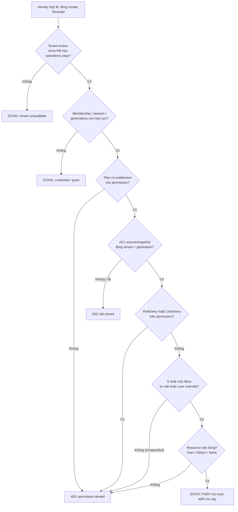
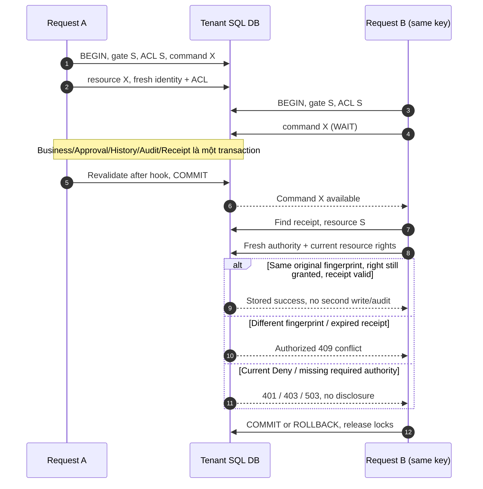
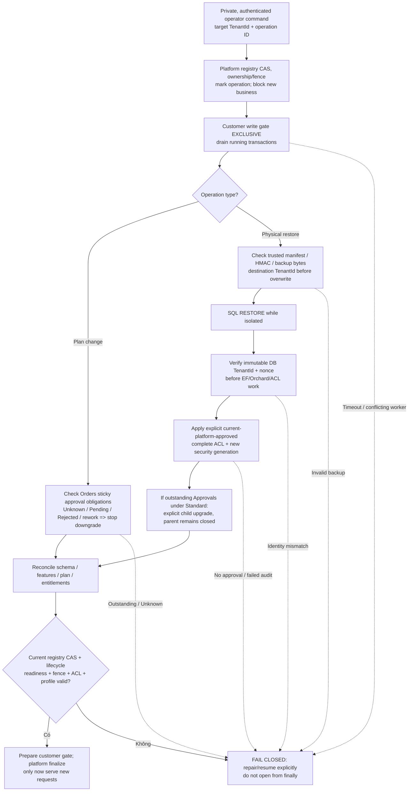

# SaasOne — Bản đồ kiến trúc bảo mật và luồng thực thi (visual)

> **Snapshot:** 2026-11-11, `main` @ [`e7aab2c`](https://github.com/chung6a8m/SaasOne/commit/e7aab2c07c3d8807ed99cb8f515c2f84638b49d2). Đây là tài liệu giải thích thiết kế và đối chiếu code, **không phải pentest, chứng nhận production hay kết quả CI mới**. Nếu code thay đổi, phải rà soát lại sơ đồ và mốc SHA. Các liên kết tương đối dẫn đến code sống của nhánh chứa tài liệu.

## 0. Đọc nhanh

| Câu hỏi | Đường kiểm soát chính |
| --- | --- |
| Request vào tenant nào? | HTTPS host/prefix được allowlist → registry ở `saas_platform` → TenantId và database nonce bất biến → connection string dựng từ **deployment secrets**, không từ token/header/body. |
| Ai là người gọi? | Orchard Users + OpenIddict (Default), cookie web hoặc JWT API; mỗi lượt kiểm tra lại session/grant, account, membership, generations, native token/authorization. |
| Có được thao tác không? | Tenant còn hoạt động + plan/entitlement + ACL snapshot cùng security generation + **Deny veto** + quyền Own/Others trên tài nguyên. |
| Request đồng thời có ghi đè không? | SQL transaction của riêng customer; durable write gate, ACL/command/resource app locks, rowversion/revision, idempotency receipt; history/audit/approval cùng commit. |
| Đang backup/restore/đổi plan? | Platform operation fence + đóng/drain write gate; database identity và current platform authority quyết định mở lại, **không tin ACL phục hồi từ backup**. |
| Rủi ro chưa đóng? | SQL-login DISABLE không hủy tức thì session đã đăng nhập; owner chấp nhận một cửa sổ race hữu hạn. M7 performance SLO và production-capacity approval chưa được xác nhận. |

**Quy ước:** mũi tên liền = luồng được phép theo kiến trúc; đường nét đứt = bảo vệ/đối chiếu hoặc tác vụ bảo trì; các nhánh “DỪNG” luôn fail closed. “Được triển khai” chỉ mô tả code tại snapshot; không đồng nghĩa xác thực mọi cấu hình hạ tầng ngoài repo.

## 1. Trust boundaries — ai chạm vào dữ liệu nào?

- `Default` và tenant shells cùng host, **không có nghĩa** cùng quyền SQL: tenant runtime principal bị giới hạn ở database tenant tương ứng; platform runtime principal được ràng buộc với `saas_platform`. Dữ liệu của tenant khác không được quyết định bởi claim client gửi lên.
- Native identity và EF Platform cùng đọc **một fixed platform database**. Tối ưu đã merge của [PR #16](https://github.com/chung6a8m/SaasOne/pull/16) chỉ mượn **một YesSQL-owned, unpooled SQL connection cho đúng một lần authority validation**; không chia sẻ qua các validation/request/tenant.
- Đường bảo trì (bootstrap, migration, plan/recovery, purge, restore/release) tách khỏi runtime và không mở dashboard operator công khai.
- **Chung browser origin là một trust boundary riêng**: path/cookie không đủ cách ly script. Repo giữ customer CMS edit, rich text, upload, custom scripts/templates/feature toggles ngoài public attack surface. Khi muốn bật upload/script phải thiết kế lại origin/content boundary trước.

**Code đối chiếu:** [IdentityRuntimeHost](../../src/SaaS.Web/Orchard/IdentityRuntimeHost.cs), [TenancyConnections](../../src/Platform/SaaS.Tenancy/Data/TenancyConnections.cs), [ApplicationRequestAuthority](../../src/SaaS.Web/Access/ApplicationRequestAuthority.cs), [ADR 0002](../adr/0002-authorization-and-cms-trust.md), [ADR 0003](../adr/0003-data-ownership-bootstrap-readiness.md).

## 2. Một business API request đi qua những cổng nào?

Ví dụ minh họa `POST /{slug}/api/v1/orders/{id}/submit`. Đối với cookie web, nhánh JWT được thay bằng cookie + session validation và form POST cần antiforgery.

**Lưu ý thứ tự:** sơ đồ gom nhóm các phép đọc cho dễ hiểu, không diễn đạt mỗi SQL SELECT là một TCP connection. Việc kiểm tra native/Platform lại là **lượt mới**, không tái sử dụng quyết định Allow từ middleware. Với web cookie, một số bước đọc current tenant riêng vẫn tồn tại. Các truy vấn source lỗi/thiếu, schema sai hoặc connection không đúng vai trò phải dừng; thông thường **401** = credential invalid, **403** = policy denied, **503** = source/operation unavailable.

**Code đối chiếu:** [IdentityAuthority](../../src/Platform/SaaS.Identity/IdentityAuthority.cs), [DefaultIssuerStore](../../src/Platform/SaaS.Identity/DefaultIssuerStore.cs), [OrdersEndpoints](../../src/SaaS.Web/Orders/OrdersEndpoints.cs), [TransactionAccessReader](../../src/Platform/SaaS.AccessControl/TransactionAccessReader.cs).

## 3. Quy tắc cấp quyền — không có Allow mặc định

- Mỗi permission được xét độc lập. **Deny thắng Allow** kể cả khi Allow từ role khác; `Unspecified` không cấp quyền.
- Với Orders: `ViewOwn`/`ViewOthers` quyết định quyền đọc; `EditOwn`/`EditOthers` và `SubmitOwn`/`SubmitOthers` lựa chọn theo **persisted creator**; `OrderApprovals.Decide` cần entitlement `Approval`, quyền đọc tài nguyên và **người quyết định khác người tạo**.
- ACL administration tái kiểm tra bên trong transaction, chặn tự thay role/override và không cho cấp quyền ngoài phạm vi actor có thể delegate. Runtime không tự tạo admin khi ACL rỗng.
- UI controls chỉ là gợi ý hiển thị. Cổng thực thi nằm ở service/policy; cùng chính sách dùng cho form, API, replay.

**Code đối chiếu:** [PermissionPolicy](../../src/Platform/SaaS.AccessControl/PermissionPolicy.cs), [PermissionEvaluator](../../src/Platform/SaaS.AccessControl/PermissionEvaluator.cs), [OrderPermissions](../../src/Modules/SaaS.Orders/OrderPermissions.cs), [AccessService](../../src/Platform/SaaS.AccessControl/AccessService.cs).

## 4. Tranh chấp khóa và request song song

Đây là **SQL Server application locks** (`sp_getapplock`) sở hữu bởi **transaction**, không phải lock C# có thể sống qua HTTP request. Trong cùng tenant DB:

| Tầng | Resource / mode | Mục đích |
| --- | --- | --- |
| 1. Write gate | `saas-tenant-write-gate-v1`: **Shared** cho business; **Exclusive** cho maintenance | Drain in-flight business, ngăn hoạt động cũ vượt plan/restore fence; kiểm tra gate version sau khi lock. |
| 2. ACL | `saas-acl-admin-v1`: **Shared** cho reader/Orders; **Exclusive** cho thay ACL | Không để cập nhật ACL chen vào giữa snapshot và policy quyết định trong transaction. |
| 3. Command | `orders-command:{partitionHash}`: **Exclusive** | Serialize idempotency cùng tenant/actor/client/action/key; không tạo duplicate success. |
| 4. Resource | `orders-resource:{orderId}`: **Shared** cho detail/replay/list, **Exclusive** cho mutation | Serialize state/revision/rowversion và quyền đọc/ghi cùng Order. |
| 5. List page | Các `orders-resource:{id}` **Shared**, lấy theo thứ tự ID tăng | Chống deadlock do nhiều page giữ các khóa tài nguyên theo thứ tự khác nhau. |

**Điểm quan trọng khi đo:** thời gian **chờ cấp lock** khác thời gian **giữ lock**; span application-side “hold” là ước lượng đến cuối transaction, **không phải xác nhận chính xác SQL đã nhả lock**. Không cộng các p95 stage lại. Diagnostic P2 của [PR #17](https://github.com/chung6a8m/SaasOne/pull/17) đã merge nhưng là **test-only**, không tạo authority cache, thay đổi thứ tự lock hay nới quyền.

**Code đối chiếu:** [TenantWriteGate / SqlTransactionLocks](../../src/Platform/SaaS.Tenancy/Operations/TenantWriteGate.cs), [TenantTransactionCoordinator](../../src/Platform/SaaS.Tenancy/Operations/TenantTransactionCoordinator.cs), [OrderService](../../src/Modules/SaaS.Orders/OrderService.cs), [M7 operation attribution](../../tests/Unit/SaaS.UnitTests/M7/M7OperationAttribution.cs).

## 5. Restore / plan change — tại sao “DB đã phục hồi” chưa mở quyền?

- Một backup tenant không có thẩm quyền hoàn nguyên **platform membership/generations/registry**, cũng không mang ACL hiện hành sau restore. Restored ACL chỉ là dữ liệu lịch sử. Session/refresh cũ không được hồi sinh.
- Suspend, PendingDeletion, expiry và stale worker fence có thể chặn lần reopen cuối, kể cả khi SQL restore hoàn tất. Purge bảo vệ permanent tombstone và không xóa global account hay tenant khác.
- Approval obligation không biến mất khi downgrade/disable feature. Một restore đưa lại pending approvals cần quyền phê duyệt child upgrade hiện hành hoặc tiếp tục đóng.
- Các đường plan và restore trong sơ đồ **khác nhau về checkpoint**; nhánh manifest/physical restore chỉ áp dụng restore, không phải mỗi plan change.

**Code/tài liệu đối chiếu:** [TenantWriteGate](../../src/Platform/SaaS.Tenancy/Operations/TenantWriteGate.cs), [TenantRecoveryOperations](../../src/Platform/SaaS.Tenancy/Operations/TenantRecoveryOperations.cs), [TenantPhysicalRestoreOperations](../../src/Platform/SaaS.Tenancy/Operations/TenantPhysicalRestoreOperations.cs), [ADR 0004](../adr/0004-lifecycle-and-plan-transition.md), [ADR 0005](../adr/0005-backup-restore-and-recovery.md), [M6 runbook](../runbooks/m6-release-backup-restore.md).

## 6. Threat → guard → kiểm thử / phạm vi chứng minh

| Tình huống tấn công hoặc lỗi | Guard tại snapshot | Evidence cần đối chiếu |
| --- | --- | --- |
| Spoof tenant bằng URL/token/header/body, trỏ nhầm SQL database | Registry + immutable TenantId/nonce + fixed-source verified tenant connection; unknown route = 404/closed | [M1 boundary tests](../../tests/Unit/SaaS.UnitTests/M1BoundaryTests.cs), [M7 SQL acceptance](../../tests/Unit/SaaS.UnitTests/M7/M7SqlAcceptanceTests.cs) |
| Token/refresh/cookie sau membership revoke, grant revoke hoặc tenant suspend | Signed/bound token, server-side fresh account/membership/family/native state, monotonic generations, single-use refresh | [Identity security tests](../../tests/Unit/SaaS.UnitTests/IdentityPoc/IdentitySecurityTests.cs), [Identity request freshness](../../tests/Unit/SaaS.UnitTests/IdentityPoc/IdentityRequestFreshnessTests.cs), [Refresh tests](../../tests/Unit/SaaS.UnitTests/IdentityPoc/IdentityRefreshTests.cs) |
| Privilege escalation qua role/override; lộ Orders của người khác | Deny veto, ACL snapshot version/generation, delegability/self-administration checks, persistent Own/Others creator | [M3 authorization](../../tests/Unit/SaaS.UnitTests/M3AuthorizationTests.cs), [M4 HTTP](../../tests/Unit/SaaS.UnitTests/M4HttpTests.cs) |
| CSRF hoặc gửi JSON giả mạo trường server-owned | Antiforgery cho web writes; API bearer + idempotency key; exact JSON/form shape, 32 KiB input cap | [OrdersEndpoints](../../src/SaaS.Web/Orders/OrdersEndpoints.cs), [M4 native HTTP](../../tests/Unit/SaaS.UnitTests/M4NativeHttpTests.cs) |
| Cùng key song song/lost response làm ghi trùng hoặc replay lộ dữ liệu sau revocation | Partitioned command lock, durable receipt, revalidate current action + read right trước replay, version/rowversion | [M4 SQL Orders](../../tests/Unit/SaaS.UnitTests/M4OrderSqlTests.cs), [OrderService](../../src/Modules/SaaS.Orders/OrderService.cs) |
| Approval tự duyệt, trùng quyết định, lịch sử bị bỏ qua khi plan tắt | Non-creator, submitted revision/rowversion, handler cùng transaction, sticky obligation/history verification | [M5 approval SQL](../../tests/Unit/SaaS.UnitTests/M5ApprovalSqlTests.cs), [ADR 0008](../adr/0008-order-approvals.md) |
| Audit thiếu nhưng business vẫn commit | Audit/revision/receipt/approval nằm trong customer transaction; failure rollback | [TenantTransactionCoordinator](../../src/Platform/SaaS.Tenancy/Operations/TenantTransactionCoordinator.cs), [M4 SQL Orders](../../tests/Unit/SaaS.UnitTests/M4OrderSqlTests.cs) |
| Backup sai tenant/tamper; restored ACL hồi sinh quyền đã revoke | HMAC/backup chain, immutable identity before warm-up, current platform recovery approval + new generation, gate closed | [M6 review evidence](../verification/m6-issue-10-evidence-review.md), [M6 restore identity tests](../../tests/Unit/SaaS.UnitTests/M6RestoreIdentitySqlTests.cs), [M6 restore refresh tests](../../tests/Unit/SaaS.UnitTests/M6RestoreRefreshSqlTests.cs) |
| SQL runtime login bị disable **ngay khi** một validation đang chạy | Fresh unpooled SQL login mỗi validation; kiểm tra `sys.server_principals` sau platform read và trước khi trả Allow | [DefaultIssuerStore](../../src/Platform/SaaS.Identity/DefaultIssuerStore.cs), [in-flight SQL tests](../../tests/Unit/SaaS.UnitTests/IdentityPoc/IdentityInFlightSqlLoginRevocationTests.cs), [owner risk decision](../decisions/issue-15-single-maintainer-security-risk-acceptance.md) |

## 7. Những giới hạn cần hiển thị rõ

1. **Residual security risk đã chấp nhận có điều kiện:** SQL Server `ALTER LOGIN ... DISABLE` không đóng một SQL session đã xác thực. Hai lần kiểm tra trạng thái login làm hẹp khoảng trống, **không tạo revocation nguyên tử**: việc disable xảy ra sau lần kiểm tra cuối vẫn có thể trùng một request in-flight. Owner duy nhất đã chấp nhận rủi ro cụ thể này tại [quyết định ngày 2026-11-11](../decisions/issue-15-single-maintainer-security-risk-acceptance.md); không có independent human security approval.
2. **Performance/production readiness chưa đạt:** M7 được đóng theo **conditional milestone acceptance** với ngoại lệ hiệu năng, không phải xác nhận SLO production. [Issue #15](https://github.com/chung6a8m/SaasOne/issues/15) vẫn Open; lịch sử 22/22 performance cells FAIL của Candidate cũ không được đổi nhãn. PR #16 (bounded connection) và #17 (diagnostic) đã merged; PR #18/P3 và PR #19/AB benchmark đã closed **without merge** tại thời điểm snapshot.
3. **Hạ tầng nằm ngoài repo:** cấu hình TLS/reverse proxy, secret manager, file permission/certificate rotation, physical SQL host, backup custody, production monitoring và năng lực phục vụ tải thực tế cần nghiệm thu riêng. SQL tests/TestServer và disposable containers không chứng minh chúng.
4. **Các bất biến không được đánh đổi để tối ưu:** không cache Allow across requests/locks; không bật global SQL pooling để “đạt số”; không đưa principal operator/migrator vào runtime; không bỏ post-lock fresh checks, audit atomicity hay durable gate; không tự động tin ACL từ backup.

## 8. Checklist khi thêm module hoặc đổi security boundary

- [ ] Route/tenant DB xuất phát từ verified shell + immutable TenantId; không tin request-supplied DB/connection/tenant.
- [ ] Permission phải có entitlement, explicit Allow, Deny veto và resource rule; cả UI lẫn API gọi cùng policy.
- [ ] Mọi mutation dùng đúng customer transaction và write gate; audit/receipt/history + extension participant cùng commit/rollback.
- [ ] Retry, concurrent request, lost response, stale revision và ACL revoke giữa lúc chờ lock có kiểm thử âm.
- [ ] Schema/history, SQL runtime privileges, backup/recovery reader và plan-off obligations được cập nhật theo **owner** thích hợp.
- [ ] Có test 4 tenant + denied Own/Others, token/session revoke, source failure, cross-DB, rollback, feature downgrade/recovery.
- [ ] Thay đổi kết nối/SQL session, native issuer hoặc ACL cần review security riêng; giữ nguyên kiểm thử và evidence nguồn-SHA.
- [ ] Tài liệu này, [ADR security](../adr/0002-authorization-and-cms-trust.md) và [risk decision](../decisions/issue-15-single-maintainer-security-risk-acceptance.md) phải được đối chiếu lại nếu bất biến thay đổi.

## 9. Bản đồ nguồn và bằng chứng

| Thành phần | Nguồn chuẩn |
| --- | --- |
| Architecture/identity | [ADR 0001](../adr/0001-identity-and-membership.md), [IdentityAuthority](../../src/Platform/SaaS.Identity/IdentityAuthority.cs), [DefaultIssuerStore](../../src/Platform/SaaS.Identity/DefaultIssuerStore.cs) |
| Tenant isolation | [ADR 0003](../adr/0003-data-ownership-bootstrap-readiness.md), [TenancyConnections](../../src/Platform/SaaS.Tenancy/Data/TenancyConnections.cs), [IdentityRuntimeHost](../../src/SaaS.Web/Orchard/IdentityRuntimeHost.cs) |
| Authorization | [ADR 0002](../adr/0002-authorization-and-cms-trust.md), [PermissionPolicy](../../src/Platform/SaaS.AccessControl/PermissionPolicy.cs), [TransactionAccessReader](../../src/Platform/SaaS.AccessControl/TransactionAccessReader.cs) |
| Atomic Orders/Approvals | [ADR 0007](../adr/0007-orders-command-contract.md), [ADR 0008](../adr/0008-order-approvals.md), [OrderService](../../src/Modules/SaaS.Orders/OrderService.cs) |
| Operation / recovery | [ADR 0004](../adr/0004-lifecycle-and-plan-transition.md), [ADR 0005](../adr/0005-backup-restore-and-recovery.md), [M6 acceptance review](../verification/m6-issue-10-evidence-review.md) |
| Current bounded risk | [Issue #15](https://github.com/chung6a8m/SaasOne/issues/15), [solo-owner security decision](../decisions/issue-15-single-maintainer-security-risk-acceptance.md), [PR #16](https://github.com/chung6a8m/SaasOne/pull/16), [PR #17](https://github.com/chung6a8m/SaasOne/pull/17) |

**Cách cập nhật:** giữ snapshot commit và ngày, kiểm tra diagram với GitHub Mermaid preview, xem diff của các file dẫn link, cập nhật table “threat → guard → evidence” và rủi ro trước khi merge. Các CI gate/benchmarks cần được chạy trên SHA của thay đổi code thực tế; chỉnh tài liệu không tự tạo chứng cứ chạy lại.
